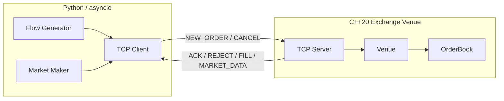

# Trading Operations Autopilot

A cross-language trading system integrating a C++20 exchange venue, Python market maker, and independent order-flow generator over TCP.

The project focuses on network protocol design, asynchronous event processing, order lifecycle management, and trading-state bookkeeping. It reuses an existing C++ order-matching core and builds the exchange and trading components around it.

## Architecture



The exchange runs as a standalone C++ process. The market maker and flow generator use independent TCP connections and can run as separate Python processes. The automated trading acceptance harness runs both Python components as asynchronous tasks in one process.

### Exchange venue

`engine/order-matching-engine/venue/`

- Single-threaded, `poll()`-based TCP server handling multiple connections.
- Custom framing protocol: 4-byte `VEN1` magic, 4-byte big-endian payload length, and JSON payload.
- Order submission, cancellation, acknowledgement, rejection, fill, heartbeat, and market-data messages.
- Client-to-exchange order ID mapping, input validation, self-cross rejection, and fill routing.
- Periodic heartbeats and market-data updates, with additional updates on top-of-book changes.
- Integration with the existing matching engine through its public API.

### Market maker

`ops-layer/market_maker/`

- Models fair value using an independent Gaussian random walk.
- Computes inventory-adjusted reservation prices and bid/ask quotes.
- Cancels and replaces resting quotes at one-second intervals.
- Updates inventory, cash, and mark-to-market PnL from received fills.
- Uses `asyncio` to coordinate message handling and periodic quoting.

The reservation price follows:

`reservation_price = fair_value - k × inventory`

where `k = 0.01`. Long inventory shifts quotes downward; short inventory shifts them upward.

### Flow generator

`ops-layer/flow_generator/noise_trader.py`

Generates marketable buy and sell orders against resting quotes at randomized intervals, producing counterparty activity through the exchange's TCP interface.

## Trading lifecycle

1. The market maker connects to the venue and submits bid/ask quotes.
2. The flow generator submits a marketable order.
3. The exchange matches the order and sends fills to the participants.
4. The market maker updates inventory, cash, and PnL.
5. The next quoting tick incorporates the updated inventory into its reservation price.
6. The market maker cancels existing quotes and submits replacements.

## Quickstart

**Requirements:** C++20 compiler, CMake, Python 3.10+. `pytest` is required for Python tests.

Build the exchange:

```bash
cmake -S engine/order-matching-engine -B engine/order-matching-engine/build
cmake --build engine/order-matching-engine/build
```

Run the automated trading acceptance harness:

```bash
python3 ops-layer/tools/trading_acceptance_test.py
```

Run a five-minute soak:

```bash
python3 ops-layer/tools/trading_acceptance_test.py --duration 300
```

For independent processes, start the venue and run the following Python modules from `ops-layer` in separate terminals:

```bash
# Repository root
./engine/order-matching-engine/build/venue_server --port 9200

# From ops-layer/
python3 -m market_maker.main --port 9200
python3 -m flow_generator.noise_trader --port 9200
```

## Testing and verification

The repository contains **131 automated tests** across C++ and Python.

| Suite | Tests | Coverage |
|---|---:|---|
| C++ | 89 | Matching, order lifecycle, allocation, framing, protocol, venue behavior |
| Python | 42 | Quoting, inventory/cash/PnL, TCP client behavior, acceptance checks, integration |
| **Total** | **131** | |

Run the test suites:

```bash
ctest --test-dir engine/order-matching-engine/build --output-on-failure

cd ops-layer && python3 -m pytest
```

The repository also includes live acceptance harnesses:

```bash
python3 ops-layer/tools/venue_acceptance_test.py
python3 ops-layer/tools/trading_acceptance_test.py
python3 ops-layer/tools/trading_acceptance_test.py --duration 300
```

The trading acceptance harness checks:

- Market-maker quoting activity and tick cadence.
- Execution of trades through the exchange.
- Inventory and cash changes following trading activity.
- Reservation-price skew direction.
- PnL logging on each quoting tick.
- Completion of trading tasks without reported exceptions.

A verified five-minute run completed **300 quoting ticks**, with all seven acceptance checks passing.

### Reproducible verification

```bash
python3 ops-layer/tools/capture_verification_evidence.py --duration 300
```

The verification runner builds the C++ project, executes both test suites, runs the acceptance workload, and stores results in an ignored `evidence/` directory.

Artifacts include test reports, execution logs, exit codes, elapsed times, environment and build metadata, source-state information, and artifact hashes.

The acceptance checks validate specific trading behaviors. They do not establish exhaustive fill reconciliation, maximum throughput, latency percentiles, or automatic failure recovery.

## Engineering decisions

**Custom TCP protocol.** Explicit message framing and protocol handling provide a language-independent boundary between C++ and Python.

**Independent fair value.** The market maker uses a private price process rather than deriving fair value from its own resting quotes.

**Inventory-aware quoting.** Reservation-price adjustments bias quotes toward reducing accumulated inventory.

**Cancel-and-requote.** Quotes are replaced every tick to keep strategy behavior straightforward and deterministic at the decision level, at the cost of additional order traffic.

**Asynchronous processing.** Fill handling and periodic quoting run as separately scheduled coroutines, allowing state updates between quoting ticks.

**Independent counterparty flow.** The flow generator exercises trading behavior through actual venue order submissions rather than synthetic state mutations.

## Repository structure

```text
engine/order-matching-engine/
├── include/          Matching-core interfaces
├── src/              Matching-core implementation
├── venue/            TCP server, framing, protocol, venue wrapper
└── tests/            C++ tests

ops-layer/
├── venue_client/     Async TCP client and protocol helpers
├── market_maker/     Fair value, quoting, state, execution loop
├── flow_generator/   Counterparty order generation
├── tools/            Acceptance and verification harnesses
└── tests/            Python tests
```
